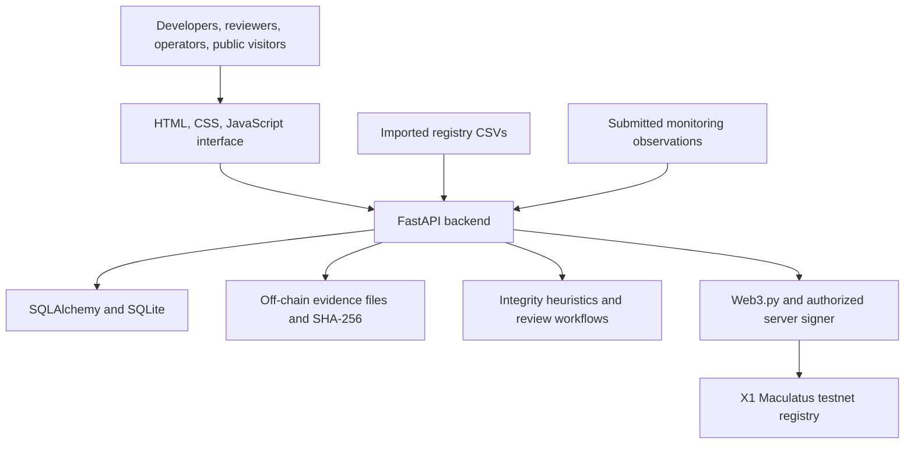

# VERICARB: The Project Explained From A to Z

Prepared on 2026-10-25 from the current repository, recorded testnet artifacts, and X1's official website and developer portal. This is a project explanation, not an independent security audit, legal opinion, climate certification, or blockchain performance benchmark. No new transactions were submitted and no tests were rerun for this guide.

## 1. The Short Answer

VERICARB is a carbon-integrity and provenance prototype. It brings together project information, supporting evidence, credit-batch records, registry conflict checks, monitoring observations, reviewer decisions, and a public verification view.

Its working name expands to "VERIfied CARBon" and its product tagline is "Every Credit. One Traceable History."

The central idea is to help someone answer: **Where did this credit come from, what supports it, what has happened to it, and has new information changed its risk?**

The strongest positioning is not "blockchain makes carbon credits true." It is: **VERICARB helps participants inspect evidence and changing risk; X1 can preserve selected identifiers, commitments, balances, and lifecycle decisions in a shared ledger.**

Today this is a working local application with a recorded X1 Maculatus testnet deployment and synthetic demonstration data. It is not a production credit certifier, a live carbon exchange, or a verified source of climate impact.

## 2. Carbon-Market Basics

A carbon credit generally represents one metric tonne of carbon-dioxide-equivalent emissions reduced or removed under a particular program and methodology. The credibility of that representation depends on the program, project, measurement, independent verification, ownership, and applicable claims rules.

- **CO2e:** a common unit for comparing greenhouse gases using an accepted accounting approach.
- **Reduction:** emitting less than a defensible baseline, such as avoiding emissions through a qualifying activity.
- **Removal:** taking greenhouse gas out of the atmosphere and storing it.
- **Baseline:** the estimated scenario against which an intervention is measured.
- **Additionality:** whether the claimed outcome would have occurred without the incentive or intervention being credited.
- **Permanence:** how long stored carbon remains stored, and how losses are managed.
- **Leakage:** emissions shifted outside the project boundary because of the intervention.
- **Vintage:** the period in which the credited outcome occurred.
- **Issuance:** creation of recognized units under a registry or program's rules.
- **Retirement:** taking a unit out of circulation for a specified use or claim.
- **MRV:** measurement, reporting, and verification. Digital MRV uses digital tools to support these activities.

VERICARB stores quantities as integer **kg CO2e**. Thus 1,000 kg equals 1 tCO2e. Smaller software denominations do not automatically create independently certified fractional credits or legal rights.

Voluntary carbon credits, compliance allowances such as EU ETS allowances, and units under a carbon-removal certification framework are not interchangeable instruments.

## 3. The Problems VERICARB Targets

| Problem | Meaning | VERICARB's approach and boundary |
|---|---|---|
| Opaque provenance | Buyers cannot easily reconstruct a unit's evidence and decisions | Connect project, evidence, batch, review, and event records |
| Duplicate issuance | The same outcome is represented more than once | Imported-record conflict checks; broader detection needs authoritative integrations |
| Double use | A unit is transferred or used again after being spent | On-chain balance and retirement rules within this registry, when those calls are used |
| Double claiming | Different parties claim the same outcome | Record claims context; authoritative accounting and legal recognition remain necessary |
| Reversal | Previously stored carbon is lost, for example after a fire | Observations, risk signals, human review, and state changes |
| Stale evidence | Old approval no longer reflects current conditions | Evidence history and a proposed continuous-monitoring workflow |
| Fragmented records | Registries and organizations maintain disconnected information | Normalized records and a shared reference layer |

These are distinct problems. Preventing a second spend in one smart contract does not prevent duplicate issuance in another registry or resolve national climate accounting.

## 4. Who It Is For

- **Project developers:** register projects, organize evidence, create batches, and respond to review requests.
- **Reviewers and auditors:** inspect material, record decisions, and resolve risk signals.
- **Registry operators and issuers:** control authorized issuance and lifecycle actions.
- **Buyers and sustainability teams:** inspect provenance, status, limitations, and retirement history before making decisions.
- **Administrators:** manage the demonstration environment and operational configuration.
- **Public visitors:** inspect a deliberately limited public verification record.

These are product audiences. Implemented application roles are developer, reviewer, issuer, and admin, with public read-only verification. Solidity separately uses admin, issuer, oracle, verifier, and balance-holder permissions. The two permission systems must be aligned operationally; they are not the same identity system.

## 5. The End-to-End Workflow

1. A user signs in or opens the explicitly labeled demo workspace.
2. A developer creates a project with location, methodology, vintage, registry references, and baseline context.
3. The developer uploads supporting evidence. The server stores the actual bytes off-chain and calculates a SHA-256 digest.
4. An evidence assessment records checks and limitations. Today this is deterministic demonstration logic, not document-understanding AI.
5. A reviewer approves, rejects, or requests more evidence.
6. Registry CSV records are imported and checked for matching serial identifiers within the available data.
7. A credit batch is created and reviewed. The API requires reviewer approval before issuance.
8. With X1 configured, authorized calls can register the project, anchor evidence, and issue the batch on-chain. Without a contract address, issuance is explicitly local-demo behavior.
9. Transfer and retirement can be demonstrated locally. The contract supports real on-chain versions, but the main application does not yet connect those API actions to them.
10. Monitoring observations can generate high-severity risk alerts. A human reviews the signal; the application updates local state and history.
11. The public verification view exposes selected batch, project, evidence-hash, score, and event information.

The intended sequence is a review-controlled workflow; not every ordering rule is enforced at every layer. For example, the API can review a draft directly, and the Solidity issuer can register a batch without an on-chain reviewer approval requirement.

## 6. A Concrete Example

Imagine a forest project claiming 1,000 tCO2e. This is an explanatory example, not proof of an actual forest outcome.

The developer uploads a monitoring report and project documents. VERICARB calculates their hashes, records the batch metadata, checks available registry records, and asks a reviewer to assess the submission. If approved, an authorized operator can register the relevant references and 1,000,000 kg batch on X1.

Later, a disturbance observation suggests a possible fire. The appropriate response is not "AI has proved the credits are false." It is to identify the affected project, preserve the observation, flag uncertainty, and obtain a reviewer decision. In the contract's implemented lifecycle, an active batch marked at risk cannot be transferred or retired until review resolves its state.

If the signal is rejected, activity can resume. If a reversal is confirmed, the batch becomes Reversed while previous balances, retirements, and history remain recorded. Replacement credits, insurance payouts, compensation, and external registry cancellation are not implemented.

One important current boundary: risk and review actions in the web application remain local. They do not yet invoke that on-chain freeze.

## 7. Architecture

Most business information lives off-chain. The backend controls authentication, permissions, data validation, workflow decisions, evidence storage, and chain submission. The contract controls its own authorized state changes and balances.

This is a hybrid architecture, not a fully decentralized application. The application server, database, administrators, evidence availability, reviewers, and signers remain important trust dependencies.

## 8. Technology Stack

| Layer | Technology | Purpose |
|---|---|---|
| Interface | HTML, CSS, vanilla JavaScript, Lucide icons | Responsive workspace, forms, navigation, and public verification |
| Browser integration | Fetch, hash-based routing, browser storage | API communication, page state, and sign-in persistence |
| API | Python 3.11+, FastAPI, Uvicorn | HTTP endpoints and application workflows |
| Validation | Pydantic 2 | Request schemas and validation |
| Persistence | SQLAlchemy 2 and SQLite | Relational project, evidence, credit, and review data |
| Schema changes | Alembic | Database migrations |
| Evidence | Local file storage and SHA-256 | Preserve evidence bytes and calculate content fingerprints |
| Authentication | scrypt password hashing; custom HMAC-SHA256 bearer tokens | Password protection and signed sessions; these tokens are not standard JWTs |
| Blockchain client | Web3.py 7 and eth-account | Read contracts, sign transactions, submit, and inspect receipts |
| Contract | Solidity 0.8.24 custom registry | Projects, evidence anchors, balances, retirement, and risk states |
| Contract tooling | Hardhat, ethers, Node.js, dotenv | Compile, test, deploy, configure, and inspect contracts |
| Testing | pytest/FastAPI test client and Hardhat tests | Backend and smart-contract checks |

This codebase is not a React app. It does not currently include a production AI service, satellite ingestion engine, IoT network, live registry federation, or payment settlement engine. IPFS is not the implemented evidence store.

## 9. The Main Data Objects

The core objects are Profile, Project, EvidenceFile, CreditBatch, CreditEvent, RegistryRecord, MonitoringObservation, Alert, Assessment, Review, Claim, and IntegrityScore.

A project groups evidence and batches. A batch holds quantity, available and retired balances, lifecycle state, identifiers, score, and optional chain references. Events describe actions. Observations can become alerts; assessments and reviews capture machine-generated context and human decisions. Score snapshots explain how the local assessment changed.

Claims are currently stored metadata, not an authorization engine. Recording an Article 6 or corresponding-adjustment field does not establish that the authorization exists or is legally effective.

## 10. Evidence, Hashing, and Privacy

SHA-256 produces a fixed-length fingerprint of file bytes. A party possessing a file can calculate its hash and compare it with the anchored digest to check whether those bytes match the committed version.

That can reveal a changed document. It does not prove who authored the original, whether the original measurements were accurate, whether the project exists, or whether an earlier unrecorded version existed.

Keeping large and sensitive files off-chain limits public disclosure and on-chain storage costs. However, a hash is not encryption or an access-control mechanism. Predictable content can sometimes be guessed and compared, metadata can reveal relationships, and lost off-chain files cannot be recovered from a digest.

Production evidence storage needs access controls, encryption, backups, durable retention, signed source attestations, malware checks, and reliable retrieval. The intended privacy model also needs a deployment fix: the current static mount serves the repository root, putting repository-contained data/configuration at risk of direct public access.

## 11. The Carbon Integrity Score

The backend uses a weighted, explainable prototype heuristic:

$$
S = \operatorname{round}(0.25M + 0.20V + 0.20C + 0.25R + 0.10A)
$$

| Component | Weight | Intended meaning |
|---|---|---|
| M | 25% | Evidence quality |
| V | 20% | Verification |
| C | 20% | Registry consistency |
| R | 25% | Reversal resilience |
| A | 10% | Authorization |

Components are bounded from 0 to 100. New batches start at 50 per component. Actions apply rules: an approved batch review raises verification to at least 65; duplicate matches can cap registry consistency at 25; an evaluated severe observation can cap resilience at 30 for active batches being marked at risk. Uploading evidence is not itself proof of quality and initially caps the evidence component at 45 pending review.

The score stores explanatory flags and snapshots. It is not an independently validated rating, a probability that a tonne is real, a guaranteed permanence measure, a price model, or a compliance certificate. A score of 80 does not mean "80% verified." Evidence age is not currently modeled as a validated freshness decay, and authorization is not automatically established from authoritative sources.

Before commercial use, the score needs published rules, representative data, calibration, independent evaluation, uncertainty treatment, versioning, and safeguards against gaming.

## 12. What The Blockchain Contract Does

The custom registry can register projects, register batches, anchor evidence hashes, transfer balances, retire quantities, mark active batches AtRisk, open InReview, and record a verifier's decision.

Transfers and retirements require an Active batch and sufficient holder balance. Retirement removes spendable units and increases the retired total. A batch becomes fully Retired when the whole batch quantity has been retired across holders.

The risk path is Active -> AtRisk -> InReview. A verifier can confirm reversal, reject the signal, or request more evidence. AtRisk and InReview prevent transfer and retirement. Confirmed reversal preserves past history rather than pretending a completed retirement never happened.

The current contract cannot put an already fully Retired batch through that risk path because risk marking requires Active. Supporting post-retirement integrity notices is a meaningful future requirement for long-lived climate claims.

This is not an ERC-20, ERC-721, or ERC-1155 credit-token implementation. It is a custom batch-and-balance ledger. No escrow, purchase payment, order book, refund system, bridge, or automatic compensation is implemented.

## 13. Why X1 EcoChain Fits

**EVM compatibility is the strongest demonstrated fit.** The existing Solidity, Hardhat, ethers, Web3.py, and Ethereum-style address tooling can work with X1 without inventing a new contract language or client stack. Repository artifacts record deployment and lifecycle transactions on its Maculatus testnet.

**A shared ledger fits multi-party provenance.** Developers, reviewers, operators, and buyers need a reference history that is not simply one seller's editable database. A public chain can make authorized actions independently inspectable, provided users verify the correct contract and network and understand the permission model.

**Small commitments fit the data model.** Hashes, identifiers, balances, and lifecycle events belong on-chain more naturally than full satellite images or private audit documents. This keeps the blockchain's role narrow and useful.

**Frequent updates could benefit from inexpensive transactions.** Monitoring and review can generate many events. Low sustainable fees would support more frequent anchoring, but actual fees must be measured for these contract calls under realistic conditions.

**Environmental efficiency is relevant, but must be substantiated.** X1's official site describes low-power nodes and Proof of Nodes consensus. A climate-oriented product should still measure full-system energy and emissions instead of treating branding as an environmental audit.

**The testnet is useful for safe engineering experiments.** Maculatus offers an RPC, explorer, and faucet. Testnet success establishes integration feasibility, not production economics, legal recognition, or network resilience.

None of these needs is exclusive to X1. Other EVM networks may satisfy them. Choosing X1 over an alternative requires evidence about reliability, governance, security, costs, ecosystem maturity, and user needs.

## 14. X1 Claims Versus Verified Project Evidence

The [official X1 site](https://x1ecochain.com/) describes an EVM-compatible Layer 1 using **Proof of Nodes (PoN)**. It advertises approximately 7.5-second block completion, 2,000+ TPS, and an approximately $0.01 average gas-price figure. The [developer portal](https://dev.x1ecochain.com/) separately describes sub-cent gas and instant finality.

Those are issuer-published descriptions, not VERICARB benchmarks. Block completion time and irreversible finality are different properties. A dollar-denominated "gas price" statement is not enough to calculate a particular contract transaction's cost, and the website figures should not be treated as a consistent service-level guarantee.

The energy language also needs care: a published "3 Wh" node figure lacks enough context by itself to establish power draw, energy per transaction, or whole-network carbon intensity. Energy per transaction depends on workload, node count, hardware, infrastructure boundaries, and electricity sources.

| Suitability question | Current conclusion |
|---|---|
| Can this stack deploy and call contracts on X1? | Recorded testnet artifacts support feasibility |
| Is every application lifecycle action synchronized? | No; only three API write flows currently submit on-chain |
| Is X1 cheapest or fastest for this use case? | Not established by this repository |
| Is consensus independently audited and sufficiently decentralized? | Requires external due diligence |
| Is energy use independently verified here? | No |
| Is production/mainnet readiness demonstrated? | No; this repository is configured for testnet |
| Does X1 certify the underlying credits? | No |

The official website lists mainnet/TGE in its Q4 2026 roadmap. A roadmap entry is not proof that launch has occurred. This guide does not independently establish current mainnet availability.

## 15. Recorded X1 Deployment

- Network: X1 EcoChain Maculatus Testnet.
- Chain ID: 10778, hexadecimal 0x2a1a.
- RPC: https://maculatus-rpc.x1eco.com.
- Explorer: https://maculatus-scan.x1eco.com/.
- Native test currency: X1T. It is used for network transactions, not a carbon credit or proof of climate benefit.
- Recorded contract: [0x5BF650b0b46D40794B116c36f75DABAcF5ed9e8b](https://maculatus-scan.x1eco.com/address/0x5BF650b0b46D40794B116c36f75DABAcF5ed9e8b).
- Recorded deployment block: 11860437; deployment gas: 3,235,252.
- Explorer source-code verification: not performed in the recorded run.

The runbook records project registration, SHA-256 evidence anchoring, and issuance of a synthetic 1,000,000 kg batch. A separate contract harness records a 1,000 kg transfer, 500 kg retirement, risk marking, review opening, and rejection of a synthetic reversal signal. Its reported final balances are 999,000 kg for the registrar and 500 kg for the reviewer, plus 500 kg retired.

These are repository-recorded results, not fresh RPC verification performed for this guide. They establish neither a real environmental outcome nor real market demand. Earlier README statements saying the contract is undeployed conflict with these later artifacts; use the dated deployment runbook for the recorded testnet stage.

## 16. What Works Now And What Is Future

| Capability | Current state |
|---|---|
| Sign-in, project management, persisted records | Implemented local application |
| Evidence upload, file persistence, SHA-256 | Implemented |
| Evidence assessment | Deterministic demo checks, not AI content analysis |
| Human review | Implemented local workflows |
| Registry conflict detection | Imported CSV exact-serial matching; incomplete by design |
| Monitoring observations and alerts | Submitted observations and explicit evaluation, not live satellite/IoT ingestion |
| Integrity score and explanation | Implemented heuristic, not validated rating |
| X1 project registration | Implemented conditional API-to-chain action |
| X1 evidence anchoring | Implemented conditional API-to-chain action |
| X1 batch issuance | Implemented conditional API-to-chain action after local approval |
| Transfer, retirement, risk, reviewer chain lifecycle | Implemented in contract and separate testnet harness; main app actions remain local |
| Public verification | Implemented database-backed projection; not a fresh chain reconciliation on every view |
| Marketplace and community | Preview/future, not a live exchange or messaging system |
| External registry issuance/cancellation | Not integrated |
| Legal authorization and corresponding adjustment | Metadata only; not independently validated |

An important custody detail: the API currently issues on-chain balances to its registrar signer, not directly to a buyer's connected wallet. Local transfer subtracts quantity and records a recipient label; it is not a complete recipient-owned ledger or payment settlement.

## 17. How This Could Change Carbon Markets

**From isolated certificates to inspectable histories.** A buyer could inspect the project's evidence commitments, reviewer actions, risk notices, and unit history instead of receiving a disconnected PDF.

**From one-time verification to continuing scrutiny.** New monitoring information could change the risk view after issuance, including after a buyer's original due diligence. This requires reliable feeds and a post-retirement notice design, not just periodic scoring.

**From blanket trust to evidence-based differentiation.** Buyers could compare evidence coverage, review status, uncertainty, and conflict information. A score should support that inspection rather than replace it with a misleading single number.

**From disconnected systems to coordinated references.** Shared identifiers, serial-range mapping, and registry integrations could make duplicate representations easier to detect. Broad adoption and authoritative data access matter more than the existence of a blockchain ID.

**From opaque retirement claims to more inspectable use.** An authoritative retirement record linked to its beneficiary and purpose could make repeated use harder. This needs external registry recognition and synchronized custody; a local or testnet retirement alone is insufficient.

**From untraceable disputes to accountable decisions.** Signed decisions and retained evidence can show who decided what, when, and on which basis. Clear appeals, reviewer independence, and liability rules are still required.

The potential change is **better information and accountability**, which may improve procurement and confidence. Higher prices, greater liquidity, reduced fraud, lower verification costs, or greater climate impact are hypotheses to measure, not demonstrated outcomes of this prototype.

## 18. Why Use Blockchain Instead Of Only A Database?

A well-managed database is cheaper and simpler for private workflows, document storage, searching, and internal reporting. VERICARB already uses one for those jobs.

A blockchain becomes useful when independent organizations need a shared, publicly inspectable reference and do not want one counterparty to control every historical record. It can enforce its own balance and role rules and preserve submitted commitments under the network's security assumptions.

It does not eliminate trust. The current system still trusts authorized issuers, human reviewers, server custody, evidence sources, and network governance. Administrators can grant roles, and dishonest or mistaken authorized actors can submit misleading material.

For a single organization with no public-verifiability requirement, signed database records and external audit may be enough. The strongest blockchain case is a genuinely multi-party workflow with defined responsibilities and verifiable reconciliation.

## 19. Adoption, Economics, And Business Model

Possible customers include registry operators, project portfolios, independent verifiers, carbon procurement teams, and due-diligence providers. Possible future revenue models include subscriptions, per-project monitoring fees, verification-workflow services, and API access. These are options, not implemented or validated revenue streams.

Production costs include qualified review, authoritative registry access, remote-sensing data, field validation, evidence retention, infrastructure, support, legal work, insurance where appropriate, and on-chain fees. Blockchain fees may be a small part of total integrity cost.

For any transaction, native-token cost is gas used multiplied by effective gas price. Converting that to fiat also requires a reliable token price. Testnet faucet tokens do not establish commercial costs.

The adoption challenge is organizational as much as technical: registries must recognize identifiers and retirements, reviewers need incentives and independence, developers need manageable reporting burdens, and buyers need credible reasons to use the records.

No native VERICARB token, token sale, or speculative incentive scheme is required for the integrity product. No carbon marketplace liquidity or investment return has been established.

## 20. Critical Risks Before A Public Production Launch

1. **Deployment exposure:** restrict static hosting to intended public assets. The current repository-root static mount creates a risk of exposing data, evidence, and configuration.
2. **Demo access:** disable unrestricted demo administrator sign-in and destructive reset in production. Demo credentials and privileges must not protect a live environment.
3. **Custodial signers:** isolate keys in an appropriate secret manager or signing service; add operational limits, rotation procedures, and stronger administrator governance.
4. **Split state:** connect remaining lifecycle actions and add reconciliation so local and chain state cannot silently diverge.
5. **Transaction reliability:** add durable pending records, idempotency, nonce coordination, retries, explicit receipt-success checks, and a documented reorg/finality policy.
6. **Contract assurance:** independently audit the contract; enforce material approval requirements at the correct trust boundary; review pause, recovery, and governance requirements.
7. **Data quality:** normalize serial ranges and project identity; define source permissions and shared conflict scope; prevent bypass through alternate IDs or registries.
8. **Session and application security:** harden browser token handling, rate limits, authorization tests, account recovery, and production TLS/security headers.
9. **Privacy and retention:** protect off-chain evidence and consider whether permanent commitments expose personal or commercially sensitive relationships.
10. **Operational maturity:** resolve dependency findings, expand tests, add backups and observability, and plan a production database and deployment architecture.

The existing test report records 49 dependency audit findings, including 20 high and 5 critical. Those are recorded findings, not a fresh audit or proof that all are exploitable in the deployed application. They still require assessment before production.

## 21. Practical Roadmap

**Phase 1: Finish the trustworthy prototype.** Reconcile stale documentation; remove production exposure risks; connect lifecycle writes; make chain/local status explicit; verify contract source on the explorer; expand role, balance, and failure-path tests.

**Phase 2: Build a controlled pilot.** Work with one project type and an authoritative partner; define custody and legal unit mapping; ingest real evidence with consent; add robust review, reconciliation, and durable storage; benchmark X1 under expected workloads.

**Phase 3: Validate integrity claims.** Evaluate score calibration and conflict coverage; measure monitoring false positives and detection delays; independently audit software and review governance; establish appeals and post-retirement risk notices.

**Phase 4: Scale responsibly.** Add registry adapters, queue-based chain processing, a scalable relational database, indexing, reliable RPC failover, and institutional governance. Consider trading or settlement only after ownership, retirement recognition, and compliance boundaries are clear.

## 22. How To Measure Whether It Is Effective

- Evidence retrieval success and time required to reconstruct a batch's history.
- Percentage of batches with authoritative source links and complete review context.
- Conflict detection precision, recall, and explicit registry coverage.
- Time between a real disturbance, detection, review, and published decision.
- Monitoring false-positive and false-negative rates on independently labeled cases.
- Reviewer agreement and frequency of overturned decisions.
- Score calibration, stability, missing-data treatment, and resistance to manipulation.
- Reconciliation failure rate between database and chain.
- Transaction success rate, confirmation/finality latency, and cost per actual operation.
- Network reliability, validator concentration, and independently assessed security.
- Total system energy/emissions under a declared measurement boundary.
- Demonstrated user adoption, willingness to pay, and reduced due-diligence effort.

Transaction count alone is not climate impact. A credible impact claim needs evidence that the system helped avoid false claims, improve decisions, or enable additional, verified environmental outcomes.

## 23. A Presentation-Ready Explanation

"VERICARB is a continuous carbon-integrity platform designed to connect a carbon credit with its evidence, reviewer decisions, registry checks, and changing environmental risk. Instead of treating a credit as a static certificate, it gives participants a history they can inspect. The prototype uses a Python API, a browser workspace, off-chain evidence, and a custom Solidity registry deployed in recorded tests on X1 EcoChain's Maculatus testnet. X1 is useful as an EVM-compatible shared-record layer, while the evidence and human-review system remain responsible for assessing the real-world claim. Our next step is to finish lifecycle synchronization and validate the system with authoritative data and independent security review. We do not claim that blockchain certifies carbon or that synthetic demonstrations create real climate impact."

## 24. Source Map

- [Project README](../README.md): current scope, setup, workflows, and product limitations.
- [Synthetic sample data](../sample-data): illustrative project, monitoring, and registry records; not certified credits or real observations.
- [Application entry point](../services/api/app/main.py): API workflows and deployment behavior.
- [Data models](../services/api/app/models.py) and [schemas](../services/api/app/schemas.py): persisted objects and validation.
- [Integrity implementation](../services/api/app/services/integrity.py): exact score formula and flags.
- [Authentication implementation](../services/api/app/security.py): password hashing and bearer tokens.
- [X1 client](../services/api/app/services/x1_chain.py): network checks, signing, receipts, and contract access.
- [Python dependencies](../services/api/requirements.txt) and [contract tooling](../services/contracts/package.json): declared stack.
- [Registry contract](../services/contracts/contracts/VericarbRegistry.sol): permissions, balances, and state transitions.
- [Frontend](../app.js): workspace flows, previews, and browser integration.
- [Blockchain architecture](BLOCKCHAIN_ARCHITECTURE.md), [network setup](X1_TESTNET_SETUP.md), and [deployment runbook](DEPLOYMENT_AND_VERIFICATION.md): integration design and recorded testnet activity.
- [Recorded test report](TEST_REPORT.md): prior validation results and unresolved dependency findings.
- [Official X1 website](https://x1ecochain.com/) and [developer portal](https://dev.x1ecochain.com/): vendor-published network descriptions, consulted for this guide.

## Final Assessment

VERICARB's strongest idea is continuous, evidence-linked accountability for carbon claims. X1 is a credible technical candidate for its shared-record layer because EVM integration is demonstrated in recorded testnet work. The project has not yet established that X1 is uniquely superior, production-ready for this application, or independently environmentally optimal.

The credible path to changing the carbon market is not merely putting credits on-chain. It is combining authoritative evidence, dependable review, recognized unit accounting, synchronized lifecycle records, and honest uncertainty in a system that participants actually adopt.